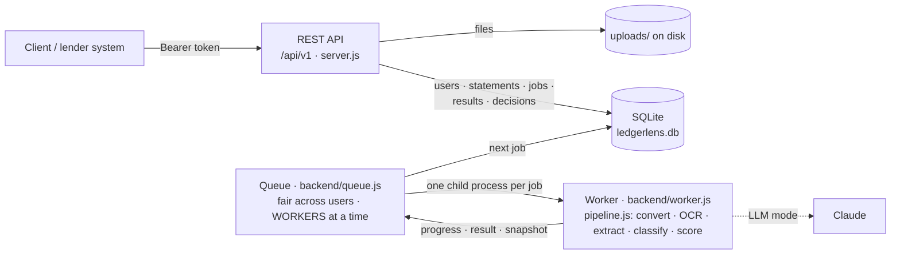

# LedgerLens — Bank Statement Analyzer (Credit Risk Lens) · Proof of Concept

[](https://github.com/bhawnamanglapm/LedgerLens1/actions/workflows/test.yml)

**Live demo:** https://claude.ai/artifact/JkAAGFzSJga3bhCpKa9Vk4 (runs in the browser, rules only). Ingest → **Show samples** has one-click practice samples and **13 example statements**, one per scenario below, each with its expected result.

**Product blueprint and MVP PRD:** [docs/LedgerLens_Product_Blueprint.pdf](docs/LedgerLens_Product_Blueprint.pdf). It covers market research on Indian and global statement-analysis players, personas, end-to-end flow, architecture, validation and risk engines, API design, user journeys, MoSCoW roadmap, MVP PRD, KPIs, UX structure, gap analysis and five differentiating bets.

LedgerLens is a proof-of-concept workflow for extracting and classifying bank-statement transactions, checking selected data-integrity rules and producing an exploratory risk score and label.

> **Prototype only — not for real credit decisions.** The score weights, cut-offs and decision labels are illustrative and have not been calibrated or independently validated on loan outcomes. Arithmetic and page-order checks can flag some inconsistencies; they cannot establish that a statement is authentic or complete. Use the synthetic samples only. Do not upload real customer or personal financial data to a public or shared deployment.

The intended reviewer is a credit analyst or product/engineering reviewer exploring a statement-analysis workflow; that audience and its needs have not been validated. See [docs/PRODUCT_STATUS.md](docs/PRODUCT_STATUS.md) for verified evidence, unknowns and the prioritized backlog.

It comes in three forms. The local app and CLI use **one engine** (`app/engine.js`); the hosted artifact has a standalone browser copy:

| | Hosted page (claude.ai link) | Local app (`npm start`) | Command line |
|---|---|---|---|
| What | Interactive UI: upload, pipeline, transactions, review queue, risk summary, activity log, taxonomy, **Knowledge sharing** (Why an LLM?, CIBIL score vs this analyzer, How the score is calculated, FAQ) | Same UI served by a small backend | Same pipeline, writes the JSON output |
| AI step | **Rules only** (no backend can run there) | **LLM (Claude)** for batch extraction and unclear-row classification, with rules as cross-check/fallback | `--llm` flag |
| Runs | In the browser | Browser + Node 18 backend on your machine | Node 18 |

The linked Claude artifact is a separate deployment: changes to `web/LedgerLens.dc.html` do not update it automatically. Its current deployed behavior and data-retention behavior have not been independently verified; use only synthetic samples there.

---

## 1. Setup

### Hosted page
Open https://claude.ai/artifact/JkAAGFzSJga3bhCpKa9Vk4. Nothing to install; the repository's artifact source has no application backend and runs the rules in the browser. Ingest → **Show samples → Example statements** runs synthetic test files in one click. The deployed artifact is separate from this source and has not been independently checked; use synthetic samples only and do not upload real financial data.

### Local app with the LLM (recommended for the review)
Quickest: run `./setup.sh` (Windows: `setup.ps1`) — it checks Node, installs, creates `app/.env` and runs the tests. Or by hand:
```bash
cd app
npm install                                  # pdfjs-dist, tesseract.js, English OCR model, xlsx
cp .env.example .env                         # then paste your Claude API key into .env
npm start                                    # → http://localhost:8787
```
PDF.js is loaded as an ES module with its matching worker. The `xlsx` dependency is pinned through the `@e965/xlsx` npm republisher at 0.20.3 because the older `xlsx` package published to npm has no patched release; re-check package provenance and run `npm audit --omit=dev` when updating dependencies. A clean dependency audit does not make uploaded files safe to process in a shared or production environment.
**API key:** create one in the Claude Console (platform.claude.com → Settings → API keys); it is shown once and starts with `sk-ant-`. Keep it only in `app/.env` (ignored by git, never zipped) or in the `ANTHROPIC_API_KEY` environment variable — never in code, the browser, screenshots or the demo recording. Optional in `.env`: `LLM_MODEL` (default `claude-sonnet-5-5`), `PORT`.
Open http://localhost:8787 → Ingest → **AI step: LLM (Claude)** is selected automatically when the key is set → upload a statement. Without a key the app still runs (rules only) and says so.

### Command line
```bash
cd app
node cli.js ../test-statements/02_multi_month_multi_account.pdf -o out.json          # rules only
node cli.js ../test-statements/02_multi_month_multi_account.pdf --llm -o out.json    # with Claude (needs ANTHROPIC_API_KEY)
node cli.js ../test-statements/03b_scanned_statement.pdf -o out.json                 # scanned PDF: needs poppler (pdftoppm)
node cli.js ../test-statements/06_password_protected.pdf --password ledger2025 -o out.json   # password-protected PDF
node cli.js --sample flags            # built-in samples: flags | clean | jumbled
node cli.js ../test-statements/02_multi_month_multi_account.pdf --taxonomy taxonomy-example.csv -o out.json   # custom categories (override / extend)
node cli.js a.pdf b.pdf c.png         # several files / accounts in one upload
```
Exit codes: `0` success · `2` password needed or wrong · `3` pipeline stopped by validation (e.g. jumbled pages) · `4` `--llm` without a key.

### Tests
```bash
cd app && npm test        # 110 checks, offline, ~1 min — no API key needed
```
GitHub Actions runs the same tests on every push (`.github/workflows/test.yml`).

### Sharing a cloud link
Only if reviewers ask: `Dockerfile` + `render.yaml`, with a password, a demo banner and model-call limits. Step-by-step in **`DEPLOY.md`**. The local server binds to `127.0.0.1` by default; if exposing it beyond the machine, set `APP_PASSWORD` because browser-password protection is bypassed when it is unset. API v1 uses separate bearer tokens. `DEMO_MODE=1` is a banner, not an access or upload restriction.

---

## 2. Architecture

```mermaid
flowchart LR
  A[Upload<br/>PDF · scan · PNG/JPG · XLSX · CSV · TXT] --> B[1 Convert<br/>pdf.js text layer · OCR for scans · Excel→CSV]
  B --> C[2 Validate page order<br/>Page X of Y per file · date continuity · missing pages]
  C --> D[3 Batch extraction<br/>LLM call per 3 pages · rule parser cross-check<br/>header metadata · inheritance]
  D --> E[Data cleaning<br/>duplicates · bad dates · bad amounts]
  E --> F[4 Enrich<br/>counterparty · channel · attributes · aliases · IFSC→bank]
  F --> G[5 Classify<br/>RULE → LLM call for leftovers → MANUAL]
  G --> H[Smart review<br/>high-impact items only · grouped]
  H --> I[6 Score<br/>6 components → 0–1000 · band · decision]
  I --> J[22 data validation checks]
  J --> K[JSON export · UI · Activity log]
  D -. /api/llm .-> L[(Backend server.js<br/>holds API key)]
  G -. /api/llm .-> L
  L -. tool use, temperature 0 .-> M[Claude]
```



| Stage | What it does |
|---|---|
| **Convert** | Digital PDF: pdf.js text layer, words re-joined left→right per line. Scanned page / image: rendered and OCR'd (Tesseract, English, SIMD + parallel workers in the browser). Excel: each sheet → CSV text, dates → DD/MM/YYYY. Password PDFs: password asked, used once, never stored. |
| **Validate order** | `Page X of Y` footers checked **per file** (each upload restarts at page 1). Detects *jumbled* and *missing* pages. Without footers, dates must not run backwards between pages. Stops with a clear error. |
| **Batch extraction** | Pages processed **3 per batch**. With the LLM on, each batch is **one model call** (see §3a); its rows replace the rule parser's only after passing the format and balance checks, and the rule parser's rows are kept as a cross-check and fallback. Header fields read per page: bank, account / card no., holder, type, currency, opening / closing balance, statement period. Pages without a header **inherit** them from the previous page / batch (and bank backwards from the next account); every inheritance is logged. Rows: table with `|`, CSV, or plain PDF text (date · [value date] · narration · amounts · balance). Single-amount rows get debit/credit from the balance movement. |
| **Data cleaning** | Exact duplicate rows across files (overlapping statements) removed; impossible dates and rows without an amount dropped — all logged. |
| **Enrich** | **Counterparty is mandatory**: parsed from narration formats of HDFC, ICICI, SBI, Axis, Kotak + generic UPI/NEFT/RTGS/IMPS/NACH/ECS/BBPS/card/ATM/cheque/foreign-remittance (SWIFT, TT, FIRC) patterns, with a confidence score; never blank (falls back to `UNIDENTIFIED` and always goes to the Review queue, whatever the amount, so a person names it). 39 merchant aliases (e.g. `AMZN`, `AMAZON PAY INDIA PRIVA` → AMAZON). Truncated legal names grouped (`ACME TECH PRIVATE LIMI` = `ACME TECH PVT LTD`). Attributes: loan a/c, card last 4, platform (Stripe, Apple Pay…), counterparty a/c, UPI ID, IFSC + counterparty bank (65 bank codes), UTR/RRN, cheque no., foreign amount/currency. **Currency:** each row's `currency` is the currency its debit / credit / balance are in (the account's); a foreign card spend such as `INTL TXN/USD 24.99/…` also carries `original_currency: USD` and `original_amount: 24.99`. |
| **Classify** | Level 1 CREDIT/DEBIT; Level 2 from a built-in taxonomy of 37 categories (13 credit, 24 debit), overridable/extendable by CSV. Order: user rules → structural rules (bounce, reversal, own-account transfer, card bill, refund, loan disbursal, salary, EMI with loan no., NACH to lender) → narration keywords (so *Tuition fee* → EDUCATION even when paid to a person) → P2P for individuals → **LLM** (one grouped model call for the rows no rule matched, answers restricted to the taxonomy's codes) → OTHER. With the LLM off, fallback keyword rules fill that slot at lower confidence and are labelled **RULE**, so `method: LLM` only appears when a model actually answered. Example override/extension file: `app/taxonomy-example.csv` (web: Taxonomy & rules → upload; CLI: `--taxonomy`). Every row stores `classification_confidence` and `method` (RULE / LLM / MANUAL). |
| **Smart review** | Rows under the threshold (default 70%) are flagged, but only **high-impact** ones are queued: ≥ ₹10k (or 5% of income), credits ≥ ₹5k (possible income), monthly recurring (possible EMI/rent), loan-related, possible bounce. Low-impact one-offs are auto-accepted and marked, except rows with no counterparty, which are always queued. Similar rows are grouped; one decision applies to all; decisions can be saved as rules for future statements. |
| **Score** | Six weighted components → composite 0–1000, band and decision with reasons (see §4). |

**Key files:** `app/engine.js` (local app/CLI engine), `app/llm.js` (model transport), `app/server.js` (backend), `app/public/` (local UI runtime + markup), `app/cli.js` (CLI), `app/pipeline.js` (headless pipeline shared by the CLI and the API workers), `app/backend/` (API v1: `db.js`, `queue.js`, `worker.js`, `api.js`), `app/test/run.js` (tests), `web/LedgerLens.dc.html` (standalone hosted-artifact source), `tools/` (synthetic test-statement generators).

---

## 3. Key design decisions

1. **Rules first, model second, human review for selected rows.** Indian narrations are semi-structured (UPI/NEFT/NACH formats); deterministic rules are inspectable in this prototype. The model handles some unresolved rows; the review queue surfaces selected uncertain items. These steps have not been validated as a lending workflow.
2. **Confidence + method on every field that matters.** Counterparty and category carry a confidence and method; reviewers can inspect how the prototype labeled them.
3. **Arithmetic checks, not authenticity checks.** Balance arithmetic is checked on rows and opening + movements = closing per account. A detected mismatch can force REFER, but valid arithmetic does not prove a statement is genuine or complete, and not every OCR or alteration error is guaranteed to be caught.
4. **Illustrative label = band + configured overrides.** The band sets a prototype label; example rules include no verifiable income → DECLINE, FOIR > 65% → DECLINE, selected flags → REFER and detected EMI bounce → at most APPROVE WITH CONDITIONS. These are uncalibrated rules, not a lending policy; reasons are shown for inspection.
5. **Not every credit is income.** Income = SALARY, BUSINESS_INCOME, INTEREST, RENTAL_INCOME only. P2P receipts, refunds, reversals, loan disbursals, own-account transfers, card payments and cash deposits are excluded.
6. **Review effort is a product constraint.** A queue nobody can finish is useless, hence materiality triage, grouping and learnable rules.
7. **Data flows vary by surface.** Browser analysis parses files locally; browser activity/rule data may persist and may sync to a connected backend. LLM mode sends extracted page text through the configured backend to the configured model. The API v1 separately stores uploaded files unencrypted in `DATA_DIR`.
8. **Shared local core, separate hosted copy.** The local app and CLI use the same engine; `web/LedgerLens.dc.html` is a standalone hosted-artifact source and is not automatically deployed.
9. **The model proposes; checks catch some errors.** Model rows are format-checked and subjected to balance checks; failed rows are retried or replaced by the rule parser. These controls do not guarantee every field is correct or prove authenticity, and do not validate a credit outcome.

## 3a. LLM integration

**Why an LLM:** bank layouts differ and change, narrations are cryptic, OCR text is messy, and some rows need judgement. Rules can't keep up with every bank; a model can read layouts it has never seen. **What it never does:** scoring, data validation, the decision — those stay deterministic and auditable.

| Step | Model call | Prompt input | Output (forced tool) | Guardrails |
|---|---|---|---|---|
| 3 Extraction | 1 per 3-page batch, up to 4 in parallel | page text + previous-batch context (account, bank, currency, last balance) | `record_transactions` — accounts seen + every row: page, date, value date, narration, debit, credit, balance, account | JSON schema · date / amount checks · exactly one of debit/credit · page in batch · account must match a header (or is inherited) · **running-balance check across batches** · retry once with the errors · then fall back to the rule parser for that batch |
| 5 Classification | 1 grouped call per 40 unclear row types | narration, amount, direction, counterparty, channel + allowed category codes | `classify_transactions` — category, confidence, reason | category must be allowed for the direction · confidence capped at 0.92 (below rules) · < 70% still goes to the Review queue |

- **Backend (`server.js`)** keeps the API key, allows only these two tools, caps requests at 2 MB, listens on 127.0.0.1, logs model, tokens and time per call.
- **Settings:** temperature 0 and a forced tool, so the answer is always schema-shaped and repeatable. Model via `LLM_MODEL` (default `claude-sonnet-5-5`). 429/5xx responses are retried with back-off.
- **Visible in the app:** Ingest → AI step switch; Batch log → *Extraction* column (rows, balance check, agreement with the rule parser, or "Fallback to rules"); Transactions → method LLM with the model's reason; Activity log → every call; JSON → `run.ai` (calls, retries, fallbacks, tokens, agreement) and `extracted_by` per row.
- **Scale:** a 100-page statement ≈ 34 extraction calls + 1–2 classification calls.
- **Privacy:** in LLM mode page text leaves the browser for your backend and the model provider. Masking names/account numbers before the call is a next step.

## 3b. Backend API (v1): storage, background queue, review decisions

The local server (`npm start`) also offers a REST API so a lender's systems can **store statements, process them in the background, keep every result and record every review decision**, for many users at once. It runs the same engine as the app and the CLI (`app/pipeline.js`), so the JSON is identical.



| Part | How it works |
|---|---|
| **Database** | SQLite (`better-sqlite3`, WAL mode) in `DATA_DIR` (default `app/data/`): `users` (only a SHA-256 hash of each token), `statements` (file on disk + name, type, size, SHA-256), `jobs` (status, stage, progress, attempts, timings, summary), `results` (versioned JSON: v1 from the pipeline, v2… after each review decision), `snapshots` (what is needed to re-score without re-reading files), `review_decisions` (who, what, old → new, note, when). |
| **Queue** | Jobs are rows in the database, so nothing is lost on a restart; interrupted jobs go back to the queue. `WORKERS` jobs run at once (default 2), **each in its own child process**, so a crash, a stuck OCR page or a 100-page statement never blocks the API. Scheduling is **fair**: the next job comes from the user with the fewest jobs running. Crashed workers are retried (`JOB_ATTEMPTS`, default 2); runaway jobs stop after `JOB_TIMEOUT_MS` (15 min). |
| **Job statuses** | `queued` → `running` → `done` · `stopped` (validation, e.g. jumbled pages) · `needs_password` · `failed`. While running, `stage` and `progress` show what the worker is doing (e.g. "OCR page 3 → confidence 91%"). |
| **Review decisions** | `POST /jobs/:id/review` changes a category and/or counterparty, re-scores from the snapshot in milliseconds (no re-reading, no OCR, no model calls) and saves a new result version. Every earlier version stays readable; every decision is in the audit trail. |
| **Shared activity log** | When the web app runs with this server, every browser's Activity log is also saved in the database (table `activity`; newest `ACTIVITY_MAX_ROWS` kept, default 200,000), alongside API job events (queued, started, done, stopped) and review decisions. In the app: **Activity log → Show: This browser / Everyone on this server**, a **Who** filter, and **Your name in the shared log**. Each browser has a random id; entries are sent every ~2 s, kept in the browser until the server confirms them, and stored once even if sent twice. *Clear my history* removes that browser's entries here and on the server. Endpoints `POST / GET / DELETE /api/activity` are protected like the page (`APP_PASSWORD`). The hosted demo has no server, so there the log stays in the visitor's browser. |
| **Users and security** | Each user gets a token (shown once, stored hashed) and sees only their own statements and jobs (others get 404). Uploads: ≤ 25 MB, supported types only, the same file twice is stored once. PDF passwords are passed with the job and kept **in memory only**, never in the database. `MAX_QUEUED_PER_USER` (default 20) stops one user flooding the queue. Sign-up: `SIGNUP=open` (default locally), `invite` (needs `INVITE_CODE`, or `APP_PASSWORD` when set; the default when `APP_PASSWORD` is set) or `off`. |

| Endpoint | What it does |
|---|---|
| `POST /api/v1/users` `{name}` | Create a user; returns the token once |
| `POST /api/v1/statements?name=a.pdf` (file body) | Store a statement |
| `POST /api/v1/jobs` `{statement_ids, llm?, review_mode?, password?, taxonomy_csv?}` | Queue an analysis of one or more statements (multi-account / multi-file) |
| `POST /api/v1/analyze?name=a.pdf` (file body) | Upload and queue in one call (`X-Statement-Password` header for protected PDFs, `&llm=1` for Claude) |
| `GET /api/v1/jobs` · `GET /api/v1/jobs/:id` | Your jobs; one job's status, stage, progress, queue position and score summary |
| `POST /api/v1/jobs/:id/password` `{password}` | Re-queue a job waiting for its PDF password |
| `GET /api/v1/jobs/:id/result[?version=n]` | The full JSON output (latest, or any earlier version) |
| `GET /api/v1/jobs/:id/review` | Items waiting for review + the categories allowed for credits and debits |
| `POST /api/v1/jobs/:id/review` `{txn_id, category?, counterparty?, note?}` | Record a decision, re-score, save a new result version |
| `GET /api/v1/jobs/:id/decisions` | Audit trail of decisions |
| `GET /api/v1/queue` | Queued / running / done counts and the number of workers |

**Try it** (with `npm start` running):
```bash
B=http://localhost:8787
TOKEN=$(curl -s -X POST $B/api/v1/users -H 'content-type: application/json' -d '{"name":"Analyst"}' | node -pe 'JSON.parse(require("fs").readFileSync(0)).token')
curl -s -X POST "$B/api/v1/analyze?name=02.pdf" -H "Authorization: Bearer $TOKEN" --data-binary @../test-statements/02_multi_month_multi_account.pdf
curl -s $B/api/v1/jobs/1 -H "Authorization: Bearer $TOKEN"            # status: queued → running → done, score 777 · REFER
curl -s $B/api/v1/jobs/1/review -H "Authorization: Bearer $TOKEN"     # 6 items to review
curl -s -X POST $B/api/v1/jobs/1/review -H "Authorization: Bearer $TOKEN" -H 'content-type: application/json' \
     -d '{"txn_id":"t63","category":"P2P","note":"advance from a friend, repaid next day"}'   # → result v2, 5 items left
curl -s $B/api/v1/jobs/1/result -H "Authorization: Bearer $TOKEN"     # full JSON (add ?version=1 for the original)
```

**Settings:** `DATA_DIR`, `WORKERS`, `JOB_TIMEOUT_MS`, `JOB_ATTEMPTS`, `MAX_QUEUED_PER_USER`, `SIGNUP`, `INVITE_CODE`, `API_LLM` (whether API jobs may use Claude: on by default locally, off when `APP_PASSWORD` is set, because these calls are not covered by the per-visitor model-call limits of `/api/llm`). In Docker the data lives in `/srv/app/data` (mount a persistent volume there).

**Limits of this version (single server):** SQLite and the in-process scheduler suit one machine with a few workers. For many servers, swap in PostgreSQL for the tables, a shared queue (e.g. Redis / BullMQ or SQS) for the scheduler and object storage (e.g. S3) for the files; the API, statuses and data model stay the same. The web app still keeps its own runs in the browser; connecting its screens to the API (history, shared review) is the next step.

---

## 4. Credit risk model

| Component (weight) | Metrics implemented | Scoring (0–100) |
|---|---|---|
| **Income Stability (25%)** | Monthly income by category, regularity (CV of primary source), source diversity, growth first→last month, level | 40% regularity · 20% diversity · 20% growth · 20% level (₹1L/month = 100) |
| **Debt Service (20%)** | EMIs per loan (by loan a/c or lender), monthly EMI total, **FOIR**, EMI bounce rate, on-time rate | 50% FOIR (≤30% = 100 … >60% = 20) · 25% bounce rate · 25% on-time |
| **Liquidity (15%)** | Average / minimum end-of-day balance (all deposit accounts combined), negative-balance days | 50% avg EOD ÷ income · 30% min EOD ÷ EMI · 20% negative days |
| **Banking Behaviour (10%)** | Bounce count, bounce charges, penalty fees, total charges, overdraft days | 100 − 25/bounce − 10/penalty − 5/overdraft day − charges |
| **Fraud Indicators (15%)** | Balance arithmetic breaks, circular transactions, overnight pass-through, structuring | 100 − 40 (integrity) − 20/circular − 15/overnight − 35/structuring |
| **Expense Management (15%)** | Essential vs discretionary, fixed vs variable, month-on-month spend trend, savings rate after EMI | 40% discretionary share · 30% trend · 30% savings rate |

**In the app:** every card on the Risk summary, the score and the decision has an **ⓘ** button that explains, in plain language, what it measures, how it is scored and the calculation with that statement's own numbers (e.g. *"₹61,750 a month ÷ income ₹1,67,111 = FOIR 37% → 85/100"*). **Knowledge sharing → How the score is calculated** walks through the same rules with the 3-account sample as a worked example.

Composite = Σ(score × weight) × 10. Bands: **Excellent ≥ 800 · Good 700–799 · Fair 600–699 · Below Average 500–599 · Poor < 500** → APPROVE · APPROVE · APPROVE WITH CONDITIONS · REFER · DECLINE (before overrides).

---

## 4a. How this differs from a CIBIL score

**In one line:** a CIBIL score shows whether someone *has repaid credit before*; this analyzer shows whether they *can afford a new loan today*. Lenders use both. The app explains this for non-specialists under **Knowledge sharing → CIBIL score vs this analyzer**.

| Question | CIBIL score (credit bureau) | LedgerLens (bank statements) |
|---|---|---|
| What it answers | Has this person repaid loans and cards in the past? | Is the income real and steady, and can they afford one more EMI now? |
| Data source | Lenders report each borrower's loans and cards to the bureau | The applicant's own bank statements |
| Income | Not visible | Measured: amount, regularity, sources, growth |
| Affordability (FOIR) | Can't be calculated without income | EMIs ÷ income; above 65% → DECLINE |
| Savings and spending | Not visible | Average / minimum balance, days below zero, essential vs discretionary |
| Fraud signals | Credit behaviour only (e.g. many applications) | Edited statements (balance arithmetic), circular flows, structuring, pass-through |
| First-time borrowers | Often no score (no credit history) | Works for anyone with a bank account |
| Freshness | As of the lenders' last report, so it can lag by a few weeks | As current as the latest statement |
| Scale | 300–900 | 0–1000 + band + APPROVE / CONDITIONS / REFER / DECLINE with reasons |
| How proven | Statistically built on millions of real loans | Weights from the brief; not yet calibrated on loan outcomes |

**Why lenders use both:** CIBIL can't see that a salary stopped last month; a statement can't see a loan repaid from another bank or an old default. Comparing the two also finds *hidden* obligations: an EMI in the statement that the bureau doesn't list (often a new fintech loan), or a bureau loan that never appears in the statements. For new-to-credit applicants, statements are often the only evidence.

**In this PoC:** statements only; no bureau data is fetched. Pulling the bureau report (with consent) and cross-checking EMIs against it is listed under Next steps.

---

## 5. Data validation — 22 checks

| # | Group | Check | On failure |
|---|---|---|---|
| 1 | On upload | Password-protected PDF | Paused until correct password |
| 2 | On upload | Empty file | Stops |
| 3 | On upload | Scanned PDF / image detected | Sent to OCR |
| 4 | On upload | OCR engine available (workers, WASM, scripts, memory) | Clear error naming the blocker |
| 5 | On upload | Transactions found | Stops |
| 6 | File | Type, ≤ 25 MB, ≤ 300 pages | Stops |
| 7 | File | Duplicate files in upload | Second copy skipped |
| 8 | File | Readable text on every page | Warning |
| 9 | File | OCR confidence ≥ 60% per page | Warning |
| 10 | Structure | Page order (jumbled / missing pages, per file; dates if no footers) | Stops |
| 11 | Structure | Account details present | Warning + fill-in form |
| 12 | Structure | Rows inside the stated statement period | Warning |
| 13 | Structure | Data covers the full stated period | Warning |
| 14 | Integrity | Running balance arithmetic on every row | **Fail → REFER** |
| 15 | Integrity | Opening + transactions = closing | **Fail** |
| 16 | Integrity | Duplicate transactions across files | Removed |
| 17 | Integrity | Valid dates (2000 … today) | Dropped |
| 18 | Integrity | Valid amounts (exactly one of debit/credit) | Dropped / flagged |
| 19 | Completeness | No gap > 35 days | Warning |
| 20 | Completeness | ≥ 3 months and ≥ 20 transactions | Warning |
| 21 | Consistency | Single currency | Warning |
| 22 | Consistency | All accounts belong to the same applicant | Warning |

All 22 results are included in the JSON output (`data_validation`).

---

## 6. Test data & results

All test statements are **synthetic**, using realistic Indian narration formats; no real customer data is used. The PDFs and scans are generated with ReportLab / Pillow by the scripts in `tools/`; `03c` is `03a` saved as JPEG (ImageMagick), `06` is `01` encrypted (pypdf), and the two CSV exports were written by hand.

| File | What it tests | Pages / accounts / txns | Result | Review items | Validation (pass / warn / fail / n.a.) |
|---|---|---|---|---|---|
| `01_single_month_digital.pdf` | Single-month digital PDF, plain-text columns, mixed HDFC/SBI/ICICI/Axis/Kotak narrations, page 2 without header | 2 / 1 / 32 | **966 · Excellent · APPROVE** | 1 (no counterparty in narration) | 17 / 1 / 0 / 4 |
| `02_multi_month_multi_account.pdf` | Jan–Mar 2025, individual + joint + credit card, metadata inheritance across 4 batches, EMI bounce, structuring, circular flow, late fee, FX card spend | 12 / 3 / 120 | **777 · Good · REFER** (structuring + circular overrides) | 6 (4 groups) | 18 / 0 / 0 / 4 |
| `03a_scanned_page1.png` | Image (photo-like noise, blur, 0.6° skew) → OCR | 1 / 1 / 18 | **959 · Excellent · APPROVE** | 0 | 19 / 2 / 0 / 1 |
| `03c_scanned_page1.jpg` | Same scanned page saved as JPEG (quality 85, ImageMagick) → OCR | 1 / 1 / 18 | **959 · Excellent · APPROVE** | 0 | 19 / 2 / 0 / 1 |
| `03b_scanned_statement.pdf` | Image-only (scanned) PDF → render → OCR | 2 / 1 / 32 | **966 · Excellent · APPROVE** (web) | 1 | 20 / 1 / 0 / 1 |
| `04_csv_export_jan2025.csv` | Bank CSV export with header rows, quoted amounts | 1 / 1 / 32 | **966 · Excellent · APPROVE** | 1 | 15 / 1 / 0 / 6 |
| `05_remittances_feb2025.csv` | Inward and outward foreign remittances (SWIFT, INW REMIT, FIRC, outward TT, LRS tuition) + an insurance premium | 1 / 1 / 9 | **937 · Excellent · APPROVE** | 0 | 15 / 1 / 0 / 6 |
| `06_password_protected.pdf` | Same statement as 01, encrypted — password **`ledger2025`** | 2 / 1 / 32 | No password → asks for it (CLI exit 2) · wrong → "Wrong password" · right → **966 · APPROVE** | 1 | 18 / 1 / 0 / 3 |
| built-in `jumbled` sample | Pages 4 and 5 swapped | — | **Stops:** "Pages appear jumbled: position 4 carries Page 5 of 12" | — | — |

### Scenario statements (`test-statements/scenarios/`)
One synthetic 3-month statement per decision and error path, generated by `tools/make_scenarios.py` (sample outputs in `sample-output/scenarios/`).

| File | Scenario | Result |
|---|---|---|
| `07_clean_salaried_approve.pdf` | Steady salary, one home-loan EMI (FOIR 22%), ordinary spending | 30 txns · **970 · Excellent · APPROVE** |
| `08_emi_bounce_conditions.pdf` | Same profile, February EMI bounced, return charge, re-presented | 27 txns · **888 · APPROVE WITH CONDITIONS** (NACH mandate) |
| `09_high_foir_decline.pdf` | Two EMIs take 73% of salary | 15 txns · **853 · Excellent · DECLINE** — FOIR above 65% overrides the band |
| `10_no_income_decline.pdf` | Money in only from friends (P2P), late fees | 18 txns · **538 · Below Average · DECLINE** — no verifiable income |
| `11_tampered_balance_refer.pdf` | Profile 07 with one printed balance edited by +₹10,000 | 30 txns · **910 · REFER** — balance arithmetic broken (possible tampering) |
| `12_jumbled_pages_error.pdf` | 4 pages, pages 2 and 3 in the wrong order | **Stops:** "Pages appear jumbled: position 2 in the file carries footer Page 3 of 4" |
| `13_cheques_review.pdf` | Six cheque formats (payee printed, self cheque, payee not printed) + a transfer with no name | 28 txns · **952 · APPROVE** · channel CHEQUE, payees read, 4 rows in the Review queue |

### Automated tests (`npm test`, 109 checks)
| Group | What is checked |
|---|---|
| LLM guardrails (10 unit tests) | correct answer accepted · misread amount caught by the balance check · both debit and credit rejected · bad date rejected · unknown account rejected · missing account inherited · row from another page rejected · malformed response rejected · category not allowed for the direction rejected · model confidence capped |
| Rules only | each test statement gives the expected rows, score and decision |
| Mock LLM | every row comes from the "model", 0 fallbacks, 100% agreement with the rule parser, same score |
| Deliberately wrong LLM (balances off by ₹1,000) | every batch rejected → fallback to rules → same score |
| Page order | jumbled sample stops with exit code 3 |
| Classification | every row has level 1, a level-2 code from the taxonomy, a confidence and a method · rules-only runs label no row LLM · P2P receipts are P2P, refunds are REFUND (credit_others), "Tuition fee" → EDUCATION · rows under the 70% threshold are flagged · remittances (SWIFT, INW REMIT, FIRC, outward TT) → REMITTANCE with the sender / payee as counterparty · keywords must start a word ("EMI" does not match inside REMITTANCE or PREMIUM) · `taxonomy-example.csv` adds and overrides categories · a reviewer's choice is MANUAL · with the (mock) LLM on, unclear rows come back labelled LLM |
| Credit risk scoring | six components with weights 25/20/15/10/15/15 add up to the composite · every metric in the brief is reported · generated customers reach every decision: clean salaried → APPROVE, one EMI bounce → APPROVE WITH CONDITIONS, FOIR > 65% → DECLINE, no verifiable income → DECLINE, one edited balance → REFER (tampering) |
| Data validation & errors | empty file, unsupported type (.docx) and a truncated PDF stop with a clear message · password-protected PDF: missing / wrong / right password · the same statement uploaded twice is de-duplicated and still scores 966 |
| Scenario statements | each file in `test-statements/scenarios/` gives its decision and reason; the jumbled PDF stops with the page-order error; cheque payees (incl. "MEHTA & SONS") are read |
| Example statements in the app | all 13 files listed under Show samples exist, and each one's "Expected" text matches a real run of the file |
| Knowledge sharing page | every template binding uses `{{double braces}}` (a single-brace typo blanks the page) · the page has its 4 topics, the CIBIL comparison, 3 worked cases, the score guide and 21 FAQ answers · the Risk summary ⓘ explanations match the real calculation (the six parts add up to the score; band → starting decision → overrides) |
| API v1 (real server, temporary database, 2 workers) | sign-up and 401 without a token · uploads (dedupe, bad type, empty) · 6 background jobs from 2 users give the CLI's scores · never more than 2 running · fair scheduling across users · users can't see each other's jobs · jumbled → stopped · password: waits, wrong, right, never stored · review: wrong-direction category rejected, decisions re-score (6 → 5 → 4 pending), audit trail and result versions · shared activity log: entries saved once, filtered by person and level, API jobs and review decisions included, *Clear my history* removes only that browser's entries · after a restart everything (including the log) is still there and an interrupted job re-runs |
| Cheques, foreign currency, long statements | a row with no counterparty goes to the Review queue even when small · 5 cheque narration formats give channel CHEQUE, the payee and the cheque number · every row's `currency` is the currency its amounts are in, and foreign card spends keep `original_currency` / `original_amount` · a generated 102-page statement runs as 34 batches with 0 fallbacks and every page inherits the account |

The mock is a **test double, not a model**: it answers in the exact tool format so plumbing and guardrails are tested offline. The real API path was also checked against a local fake of the Messages API (headers, forced tool, temperature 0, 529 retry, tool_use parsing).

Sample outputs (transactions + credit risk summary + validation) are in `sample-output/*.output.json` and `sample-output/scenarios/` (rules mode; LLM runs add `run.ai` and `extracted_by`). Schema: `ledgerlens.bsa.v1` — `run`, `accounts`, `data_validation`, `transactions[]`, `credit_risk_summary{composite_score, rating_band, decision, decision_reasons, components[], metrics{income_stability, debt_service, liquidity, banking_behaviour, fraud_indicators, expense_management}}`.

### Limitations observed with the test data
- **OCR digit errors are real and are caught.** Running the scanned PDF through the CLI (poppler 200 dpi render) misread `1,532.40` as `1,632.40` on one row. Checks 14 and 15 failed and the decision was forced to **REFER** (906) instead of APPROVE — the intended safety behaviour. The browser render of the same file read every row correctly (966). At 300 dpi the CLI lost 5 rows, so 200 dpi is the default.
- **OCR punctuation noise** (`UP!`, `NWD:-`, stray `.`/`’` between columns) is cleaned before parsing; a speck between amount columns used to swallow an amount and is now handled.
- **Numbers inside narrations** (`INTL TXN/USD 24.99/…`) were initially read as an amount; the parser now only takes amounts at the end of the line.
- **Mandate debits without "EMI"** (`ACH D- TATA CAPITAL LTD-…`) were initially OTHER and missed in FOIR; a rule now treats NACH/ACH debits to lenders as EMI (0.82).
- A **single scanned page** of a two-page statement correctly warns *"data 01/01–17/01 vs stated 01/01–31/01"*.

---

## 7. Assumptions

| Area | Assumption | Why |
|---|---|---|
| Geography | Indian statements, INR, DD/MM dates, Indian digit grouping (1,42,500.00) | Target market of the platform |
| Dates | MM/DD/YYYY not supported | Ambiguous with DD/MM; Indian banks use DD/MM |
| Income | Only SALARY, BUSINESS_INCOME, INTEREST, RENTAL_INCOME count | Brief: not every credit is income |
| Salary | Keyword SALARY/PAYROLL/SAL from a non-person, or a company credit recurring ≥ 2 months | Common employer-credit patterns |
| EMI | Debit with a loan a/c no. + EMI/ACH/NACH, or NACH/ACH to a lender | Banks rarely print "EMI" on every mandate |
| FOIR | Sum of latest EMI per identified loan ÷ average monthly income (rent excluded) | Standard lender definition of fixed obligations |
| Overdraft usage | Days where any deposit account's end-of-day balance < 0 | No OD limit is printed on statements |
| Overnight transactions | ≥ ₹50k credit followed by ≥ 90% debited within 1 day (pass-through) | Statements rarely show timestamps |
| Circular transactions | Credit and debit of ≈ same amount (±2%) with the same counterparty within 3 days | Round-tripping pattern |
| Structuring | ≥ 3 cash deposits of ₹40–50k within 30 days | Just under the ₹50k PAN-reporting threshold |
| Expenses | EMIs, investments, own transfers and card bill payments excluded from spend | Avoids double counting and keeps debt separate |
| Foreign currency | Amounts are in the account's currency; a foreign card spend or remittance keeps the printed foreign amount in `original_currency` / `original_amount` | Statements show the converted INR amount that moved the balance |
| Overlapping uploads | The same row (account, date, narration, amounts, balance) in two files is one transaction; each file's first page restarts the running balance at its own opening balance | Customers often send overlapping or repeated statements |
| Joint / card accounts | Belong to the same customer; card balance = outstanding (debit increases it) | Typical multi-account upload |
| Review threshold | 70% default, adjustable; smart review on by default | Balance between accuracy and reviewer effort |
| Score weights | As given in the brief; component formulas and cut-offs are illustrative and should be calibrated on historical defaults | No outcome data in a PoC |

---

## 8. Known limitations

1. **LLM accuracy not yet measured on real statements.** The integration is real and tested end to end with a mock and a fake API, but this package was not run against the live model with real bank statements; accuracy, cost and latency should be measured on a labelled set before production. The hosted claude.ai page runs rules only (no backend there).
2. **Narration formats.** Built from public explainers and common patterns; banks vary by core system. Unknown formats fall to review and can be taught via counterparty rules (stored per browser).
3. **OCR.** English only; quality drops on blurred, skewed or low-resolution scans. Integrity checks may flag some digit errors but cannot guarantee detection or correct them.
4. **Cheques** often don't print the payee. When it is printed after the cheque number (`CHQ PAID-000451-NAME`, `TO CLG CHQ NO … NAME`, `BY CLG/…/NAME`) it is read; otherwise the row gets *Cheque counterparty (not printed)* at 55% and always goes to the Review queue.
5. **No external data:** no MCC codes for card merchants, no UPI-ID name lookup, IFSC resolves to bank (not branch), no bureau cross-check of EMIs.
6. **Persistence and privacy:** the API (§3b) stores uploaded statements, jobs, result versions, review decisions and the shared activity log in SQLite/on disk on one server. Uploaded files are stored unencrypted in `DATA_DIR`; no retention or deletion policy is documented here. The web app also keeps runs and counterparty rules in browser local storage; its activity log is copied to the server when connected. The local app has no analyst/approver roles. Treat this as a prototype, not a production data-handling design.
7. **Scoring and statement integrity:** scores are rules-based and uncalibrated (see Assumptions). A balanced statement can still be altered or incomplete; the checks do not prove authenticity.
8. **Demo mode is a notice, not an input control:** `DEMO_MODE=1` displays a synthetic-data banner, but does not technically block real uploads or enforce synthetic-only use. Restrict access and use synthetic data; do not expose a shared deployment without an owner-reviewed access and data-retention plan.
9. **Hosted artifact:** this repository contains a source file, not a verified deployment pipeline for the linked Claude artifact. Updating the source does not update the live URL.
10. **Dependency security:** `npm audit --omit=dev` reported four advisories in the installed dependency tree (three high, one critical), including `pdfjs-dist`, `xlsx` and a transitive `tar` dependency. They have not been remediated; assess affected package paths and compatible parser upgrades/replacements before using the upload surface with untrusted files.

---

## 9. Next steps
See the P0/P1/P2 backlog and completion conditions in [docs/PRODUCT_STATUS.md](docs/PRODUCT_STATUS.md). Before any real-data or lending use, prioritize a privacy/retention/access review and independent evaluation on appropriately consented, representative data. Do not treat infrastructure scale-up or a polished demo as evidence of readiness.

See `DEMO_SCRIPT.md` for the walkthrough recording.
---

## 10. FAQ (plain language)

The same questions are answered in the app under **Knowledge sharing → Common questions**.

**What does this app do?** It is a proof of concept that extracts and classifies transactions, runs selected arithmetic/page checks and shows an experimental 0–1000 score with a rules-based label. Those checks cannot establish that a statement is genuine. The score and label are not validated for credit decisions.

**Which files can I upload?** PDF statements (digital or scanned), photos or scans of pages (PNG, JPG), Excel and CSV downloads from internet banking, and text exports. Password-protected PDFs work; the app asks for the password.

**What is OCR?** Software that reads the text in a picture, so scanned pages and phone photos can be understood. Blurry or tilted images can cause reading mistakes; the balance checks catch them.

**What does the 0–1000 score mean?** It is the output of six developer-defined, weighted prototype rules: income stability 25%, existing debt 20%, cash cushion 15%, banking habits 10%, fraud signals 15%, spending habits 15%. The band cut-offs are illustrative; the score is not a probability of default, bureau score or validated measure of creditworthiness.

**What do the four decisions mean?** They are labels emitted by prototype rules, not instructions to lend or decline. Their thresholds have not been validated; a human review of flagged transactions does not make the result a validated credit decision.

**What is FOIR?** Fixed Obligation to Income Ratio: the share of monthly income already going to EMIs. Earn ₹1,00,000 and pay ₹40,000 in EMIs → FOIR 40%. The prototype has an illustrative 65% override; it is not a validated lending policy.

**What is an EMI bounce?** A loan instalment the bank couldn't collect because the account didn't have enough money; it is returned unpaid, usually with a fee. The prototype has a heuristic that can change its label after a detected bounce; this is not a validated policy.

**Why does a result say "provisional"?** Some transactions could not be read or categorised with confidence. Resolving review items changes the prototype analysis status; it does not establish accuracy or make the output a final lending decision.

**Can it tell if a statement was edited?** It checks selected arithmetic and page-order rules. Some alterations may cause a mismatch, but a consistent edit or fabricated statement can pass. These checks do not verify authenticity.

**What is "structuring"?** Cash deposits kept just under ₹50,000, the amount above which a PAN must be quoted. Three or more within a month is a warning sign.

**What is a circular transaction?** Money that arrives from someone and goes straight back to them within a few days; it makes an account look busier or richer than it is.

**Why isn't every credit counted as income?** Money from friends, refunds, loan amounts received, transfers between your own accounts and cash deposits aren't earnings. Only salary, business income, interest and rent count.

**What do RULE, LLM and MANUAL mean?** Who labelled a transaction: fixed rules, the AI model (only for lines the rules couldn't settle), or a person in the Review queue.

**Does the AI make the lending decision?** The model can help extract or classify transaction data in local LLM mode. Some outputs are checked by rules and arithmetic checks, but that does not guarantee every field is correct. Prototype score labels come from fixed rules and are not validated lending decisions.

**Why does the online demo say "Rules only"?** The AI needs a private API key, which must never be in a public web page. The full AI mode runs locally with its own small server holding the key.

**Where does my statement go?** In the repository's browser-only artifact source, files are processed in the browser, but browser-side activity/rule data may persist; the deployed third-party artifact has not been independently checked. In the local web app, LLM mode sends extracted page text through the configured backend to the configured model, and activity may be saved on the server. The separate API v1 stores uploaded files unencrypted under `DATA_DIR`. PDF passwords are used to open a file and are not intentionally saved. Use synthetic data only; `DEMO_MODE=1` shows a banner but does not block real data.
