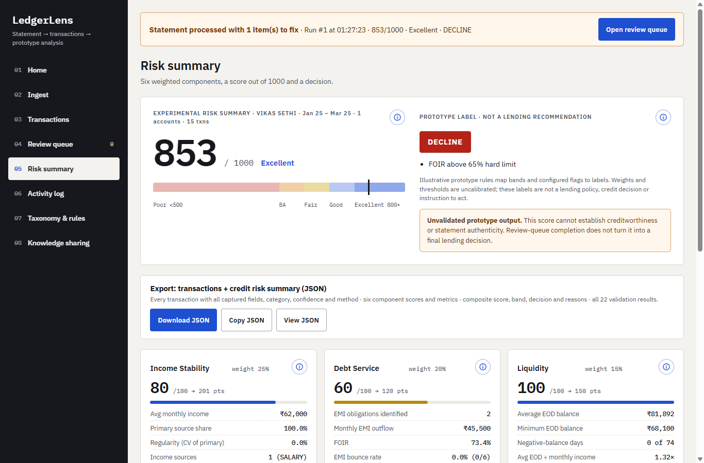
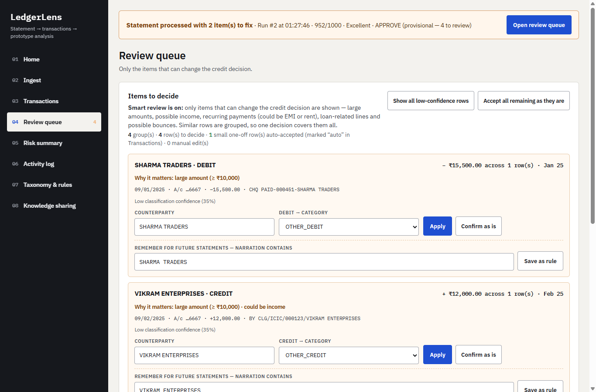

# LedgerLens: bank-statement analysis a credit officer can check

LedgerLens reads a borrower's bank statements (PDF, scan, photo, CSV or Excel), turns them into labelled transactions,
checks the statement for signs of tampering, and gives a 0–1000 risk score with a recommendation and the reasons
behind it. Each part of the score explains itself using that statement's own numbers.

*Above: an applicant scores 853 "Excellent", yet the recommendation is DECLINE, because two loan EMIs take 73% of
their salary. A good average must not hide a hard limit. Synthetic test statement `09_high_foir_decline.pdf`,
captured from the local app on 19 Oct 2026.*

> **Prototype only, not for real credit decisions.** Score weights and cut-offs are illustrative and have not been
> calibrated on loan outcomes. The tamper checks can catch some edits but cannot prove a statement is genuine. All
> statements in this repo are synthetic. Do not upload real customer data.

**Try it:** [live demo](https://claude.ai/artifact/JkAAGFzSJga3bhCpKa9Vk4) (runs in the browser, rules only; the
hosted copy is deployed separately and was not re-checked for this update) · run locally: `cd app && npm install && npm start`
· [technical reference](docs/TECHNICAL.md) · [PRD](docs/PRD.md) · [decision log](docs/decisions.md) · [evals](evals/) ·
[changelog](CHANGELOG.md) · [status and backlog](docs/PRODUCT_STATUS.md) · [product blueprint (PDF, 69 pages)](docs/LedgerLens_Product_Blueprint.pdf)

---

## Problem

When a lender assesses a loan, a credit officer reads the applicant's bank statements to answer three questions: is
the income real and steady, can they afford one more loan repayment, and has the statement been edited? Statement
analysis tools exist, but the
[product blueprint](docs/LedgerLens_Product_Blueprint.pdf) (section 2) describes the gap this project explores:
reports are long and unexplained, officers re-check salary, EMIs and bounces by hand, and they cannot see which
numbers are guesses. The blueprint estimates 20–45 minutes per file; that figure is marked there as approximate and
was not measured.

LedgerLens tests one idea: **an analysis the officer can verify is worth more than a score they have to trust.** So
every transaction shows how it was labelled and how confident the system is, every score component explains itself
with the statement's own numbers, and only the rows that could change the decision go to a person for review.

> **OWNER INPUT NEEDED:** where the original brief came from (the scoring weights in
> [the model](docs/TECHNICAL.md#4-credit-risk-model) are "as given in the brief"), and whether you have spoken to credit
> officers or underwriters about this problem. No user research is recorded in this repo.

## Why AI, and why not just rules

| Job | Who does it | Why |
|---|---|---|
| Reading statement layouts, including formats never seen before | Rules first; the model (Claude) for each 3-page batch when AI mode is on | Every bank prints statements differently and formats change. Rules alone break on new layouts; a model can read them. |
| Labelling rows that no rule recognises | The model, limited to the allowed categories, then a person if confidence is below 70% | Narrations are cryptic (`UPI/5021234567/RAHUL VERMA/...`). Rules settle most rows; the model handles the leftovers. |
| Data checks, score, decision | **Rules only. The model is never used here.** | A lender has to defend each decision to an auditor or the borrower. Fixed rules give the same answer every time and can be explained line by line. |

The model's output is checked before it is used. Each batch must pass format checks and a running-balance check;
if it fails twice, that batch falls back to the rule parser. Calls use temperature 0 and a forced tool schema, so
the output always has the same shape. The model also has a ceiling: its classifications are capped at 92%
confidence, below the rules.

## Key decisions and tradeoffs

Full log with dates: [docs/decisions.md](docs/decisions.md).

1. **Rules first, model second, person last.** *Gave up:* some coverage of unusual formats in rules-only mode.
   *Got:* most rows are explainable without a model call, which keeps cost down and makes failures traceable. On
   the synthetic samples, rules alone labelled 287 of 300 rows at 70% confidence or higher. Real statements will be
   messier; this has not been measured on them.
2. **Hard limits override the score.** No verifiable income → DECLINE; loan repayments above 65% of income (FOIR) →
   DECLINE; broken balance arithmetic → REFER; a bounced loan repayment → at most APPROVE WITH CONDITIONS. *Gave up:*
   a single number that "speaks for itself". *Got:* a good average cannot hide a deal-breaker (see the screenshot).
3. **Not every credit is income.** Only salary, business income, interest and rent count. Money from friends,
   refunds, loan disbursals and transfers between the applicant's own accounts do not. *Gave up:* a higher income
   figure for gig and informal earners, who may be under-counted. *Got:* income cannot be inflated by moving money
   around.
4. **Review effort is a product constraint.** Only rows that could move income, FOIR or a hard rule are queued;
   similar rows are grouped and one decision covers them; a fix can be saved as a rule. *Gave up:* a person looking
   at every uncertain row. *Got:* a queue an officer can finish (0–6 items per statement in the eval set).
5. **Check arithmetic, never claim authenticity.** The balance on every row must follow from the previous one, and
   opening plus movements must equal closing. A mismatch forces REFER. *Gave up:* a "verified genuine" badge. *Got:*
   an honest signal; a carefully consistent forgery can still pass, and the app says so.
6. **Labels must tell the truth about who decided.** Every row carries `method` (RULE / LLM / MANUAL) and a
   confidence. On 2 Oct 2026 this caught a bug where rows were labelled LLM even though no model had run.

## How I measured quality

**Eval set:** [20 statements and bad inputs](evals/cases.json), each with the outcome a careful analyst would expect:
clean approvals, a bounced EMI, high FOIR, no verifiable income, an edited balance, jumbled pages, cheques with no
payee, scans and photos, CSV exports, a password-protected file, the same statement uploaded twice, and AI mode
requested with no key. All are synthetic, and each one was built to plant a specific problem.

**Criteria:** the decision matches; when a hard rule decides, the reason names it; the score and transaction count
match exactly; uncertain rows reach the review queue; and unusable files stop with a clear message instead of
producing a score.

**Results** ([evals/results-rules.md](evals/results-rules.md), run 19 Oct 2026 with `node evals/run_evals.mjs`):

| Criterion | Rules mode |
|---|---|
| Credit decision correct | 14 / 14 |
| Hard-rule reason named | 4 / 4 |
| Score and transaction count exact | 14 / 14 |
| Bad input stopped with the right message | 4 / 4 |
| Review queue size exact | 1 / 1 |
| **Cases passed** | **19 / 19** (1 not run: the scanned PDF needs poppler, which is not installed on the machine used) |
| AI mode (`--llm`) | **Not run yet.** It needs the owner's API key: `node evals/run_evals.mjs --llm` |

**Before and after.** The automated suite (110 checks, run in CI on every push) caught these bugs during the build.
Each fix is in the commit history:

| Found by a test | Before | After | Commit |
|---|---|---|---|
| Same statement uploaded twice | 1 duplicate row survived; **966 APPROVE became 853 REFER** | Duplicates removed; still 966 APPROVE | `cc44e74`, 2 Oct |
| Applicant with no income and no loans | Declined for "FOIR above 65%", a ratio that cannot be computed without income | Declined for "No verifiable income"; FOIR shown as n/a | `40b9ee4`, 2 Oct |
| Foreign remittance and insurance premium | "EMI" matched inside "REMITTANCE" and "PREMIUM", so both were counted as loan repayments | Keywords must start a word | `e52bc26`, 2 Oct |
| Rules-only run | Fallback rows labelled LLM although no model ran | Labelled RULE | `8e157b0`, 2 Oct |
| Small transfer with no name | Auto-accepted without review | Always queued, since every row needs a counterparty | `b50101c`, 2 Oct |
| Scanned PDF read at 300 dpi | 5 rows lost | 200 dpi is the default (documented in the README; not re-measured here) | — |

**What this does not show:** accuracy on real bank statements, accuracy in AI mode, or whether the score predicts
default. That needs a labelled set of real, consented statements and repayment outcomes; the
[PRD](docs/PRD.md) makes this step 1 of a pilot.

## Failure modes and guardrails

| What can go wrong | Guardrail | Proven by |
|---|---|---|
| Pages out of order or missing | Page footers and dates checked per file; the pipeline stops | Eval E16, E18 |
| An edited balance | Running-balance and opening/closing arithmetic; failure forces REFER | Eval E15 |
| The model misreads an amount | Balance check rejects the batch; one retry, then the rule parser takes over | Test suite: a deliberately wrong mock model, every batch rejected, same score |
| The model invents a category | Answers restricted to the taxonomy codes allowed for that direction | Test suite (LLM guardrail unit tests) |
| OCR misreads a digit | The balance check usually breaks, so the case is referred rather than approved | Documented run: one misread digit forced REFER (906) instead of APPROVE |
| A row the system is unsure about | Below 70% confidence and able to move the decision → review queue; no counterparty → always queued | Eval E17 (4 cheque rows queued) |
| Locked or unreadable file | Asks for the password (never stored); unsupported or corrupt files stop with a message | Eval E08–E10; test suite |
| AI mode with no key | Refuses to start (exit code 4) instead of silently running rules | Eval E20 |
| Someone treats the label as a lending decision | The risk summary marks it "Prototype label · not a lending recommendation", with an "unvalidated prototype output" warning | Screenshot above |

Known gaps: real-data privacy and retention are not designed (the API stores uploads unencrypted), and `DEMO_MODE` is a
banner, not a block. See [known limitations](docs/TECHNICAL.md#8-known-limitations).

## Users and iteration

*The review queue on `13_cheques_review.pdf`: four cheque rows with no clear payee, each with the reason it matters
("large amount", "could be income").*

> **OWNER INPUT NEEDED.** This repo has no record of testing with users. Please add who you showed it to (role, not
> name), what they did, and what changed as a result. If nobody has used it yet, say so; that is an honest answer.
>
> **"I was wrong about…" candidates from the build record** (pick one and say it in your own words, or replace it):
> - *Uploads:* assuming each statement arrives once. In practice customers send overlapping statements, and one
>   surviving duplicate changed APPROVE to REFER.
> - *Keywords:* assuming a keyword match was safe anywhere in the text, until "EMI" matched inside "REMITTANCE".
> - *Review:* assuming small, unnamed transactions could be auto-accepted. A row with no counterparty now always goes
>   to a person.

## What's next

1. **Run the evals in AI mode** and publish the comparison against rules mode (owner's key; cost to be reported from the run).
2. **Decide the data-handling boundary** before any shared deployment: access, retention and deletion, and model-provider terms. This is open P0 in [PRODUCT_STATUS.md](docs/PRODUCT_STATUS.md).
3. **Build a labelled set from real, consented statements**, then measure extraction and categorisation accuracy per bank. The [PRD](docs/PRD.md) targets 97% row accuracy and 95% on income, EMI and transfer categories; these are targets, not results.
4. **Calibrate the score on repayment outcomes**, and only then treat the bands as more than illustrative.
5. Bureau cross-check (find EMIs the credit bureau doesn't list) and masking names and account numbers before model calls.

## How I built it

Product owner, built with AI (Claude). The code was written with Claude Code; commits are co-authored by Claude.

> **OWNER INPUT NEEDED:** confirm or edit this line before publishing: *"Implemented with Claude Code; I owned the
> problem framing, architecture decisions, evals and testing."* The repo shows what was built and when, but not who
> decided what.

**Stack:** Node.js, one shared engine for the web app, CLI and API (`app/engine.js`); pdf.js and Tesseract for
reading files; Claude via a small backend that holds the API key; SQLite for the API. Setup, architecture and every
rule are in the [technical reference](docs/TECHNICAL.md).
